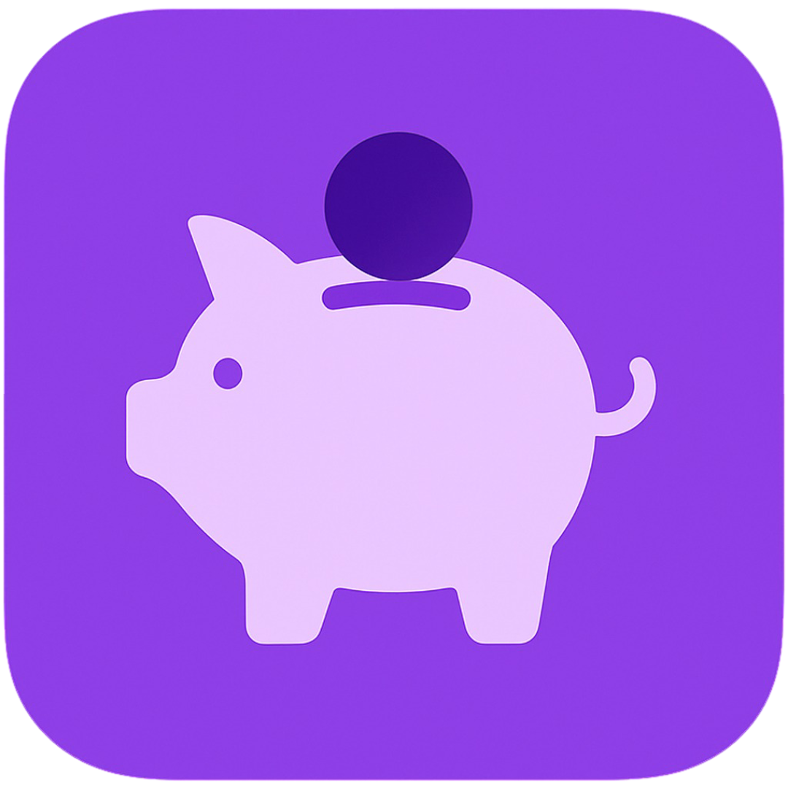
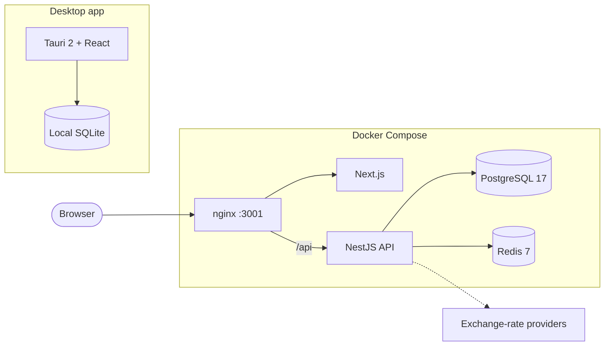

<div align="center">



<h1>MyMoney</h1>

**Personal finance, online and offline.**

Track income, expenses and transfers across multi-currency accounts, understand where the money goes, and keep using the app even without a connection.

[](https://github.com/zoom1fy/mymoney/releases)
[](LICENSE)
[](https://github.com/zoom1fy/mymoney/releases)

[](https://nextjs.org/)
[](https://nestjs.com/)
[](https://tauri.app/)

[English](README.md) · [Русский](README.ru.md) · [Changelog](CHANGELOG.md)

</div>

---

## Overview

MyMoney is a self-hosted personal finance manager built as a full-stack web app and an offline-first desktop app. It keeps every account, category and transaction in one place, converts multi-currency balances into a single base currency, and turns the transaction history into readable charts.

The web version runs on Next.js and NestJS with PostgreSQL, Redis and nginx. The desktop version wraps the same interface in Tauri and stores everything in a local SQLite database, so it works with no backend and no network.

The interface is currently in Russian; the API and documentation are in English.

## Highlights

| Capability | What you get |
|---|---|
| 💸 **Multi-currency accounts** | Six account types across four sidebar groups, each with its own icon and currency. Balances stay in the original currency; group totals are converted to RUB. |
| 📊 **Spending analytics** | Donut charts for income and expenses with a date-range filter. Aggregation runs on the server, so the browser only renders the result. |
| ⚡ **One-request dashboard** | `GET /api/dashboard` returns the profile, accounts, category totals, categories and both summaries in a single round trip. |
| 🔁 **Income, expenses, transfers** | Hierarchical categories with colors and icons, descriptions, dates and cursor-paginated history. Transfers update both accounts in one database transaction. |
| 🔐 **Secure by default** | JWT access and refresh tokens, Argon2 password hashing, email verification, single-use password-reset codes and two layers of rate limiting. |
| 💻 **Web and desktop** | The same React interface ships as a website and as a Tauri app with local SQLite, SQL-maintained balances and manual backups. |
| 🎨 **Comfortable UI** | Light and dark themes, optimistic updates through TanStack Query, loading skeletons, animations and a layout that works on mobile. |
| 🛠 **Ready to run** | Docker Compose stack, nightly PostgreSQL backups, GitHub Actions CI and multi-platform releases. |

## Quick start

### Prerequisites

- [Docker Desktop](https://www.docker.com/products/docker-desktop/) or Docker Engine
- [Bun](https://bun.sh/) 1.2 or newer (only needed for local scripts and builds)
- Git
- Free ports: `3001`, `4200`, `5432`, `6379`, `8080`

### 1. Clone and configure

```bash
git clone https://github.com/zoom1fy/mymoney.git
cd mymoney
cp .example.env .env
```

On Windows PowerShell, use `Copy-Item .example.env .env` instead of `cp`.

Open `.env` and set at least these values:

```env
POSTGRES_USER=postgres
POSTGRES_PASSWORD=change-me
POSTGRES_DB=mymoneydb
DATABASE_URL=postgresql://postgres:change-me@db:5432/mymoneydb
JWT_SECRET=replace-with-a-long-random-string

# Needed for sign-up verification and password recovery
SMTP_HOST=smtp.yandex.ru
SMTP_PORT=587
SMTP_USER=you@yandex.ru
SMTP_PASS=your-app-password
SMTP_FROM=you@yandex.ru
SMTP_TLS=true
```

The remaining variables already have working defaults in `.example.env`.
Email confirmation is mandatory, so the SMTP values must be valid — otherwise
registration cannot be completed. For Yandex Mail, use an application password
instead of the account password.

### 2. Start the stack

```bash
# macOS / Linux
./deploy/deploy.sh

# Windows
deploy\deploy.bat
```

The script asks whether to run the development or production configuration.
To skip the prompt, start the development stack directly:

```bash
bun run docker:up
```

The first build takes a few minutes. Database migrations run automatically when
the backend container starts.

### 3. Open the app

| Service | URL |
|---|---|
| MyMoney | <http://localhost:3001> |
| Adminer | <http://localhost:8080> |

Create an account, confirm the 6-digit code sent by email, and the dashboard is
seeded with starter categories, two accounts and sample transactions.

## Desktop app

The desktop build is fully offline: it uses a local SQLite database instead of
the API and does not require PostgreSQL, Redis or a server.

- **Download** the latest MSI, DMG, AppImage, deb or rpm from
  [Releases](https://github.com/zoom1fy/mymoney/releases).
- **Back up** the database from Settings → Data → Save a copy. The file is
  written with SQLite's `VACUUM INTO`, so the copy is consistent even while the
  app is running.

To build it yourself you need the [Tauri prerequisites](https://tauri.app/start/prerequisites/)
for your platform, a Rust toolchain and Bun:

```bash
bun run setup
bun run dev:desktop      # development window
bun run build:desktop    # installers in desktop/src-tauri/target/release/bundle
```

## Architecture



Nginx exposes a single origin: everything under `/api` goes to NestJS, the rest to Next.js. The desktop app bypasses the server entirely and runs the same frontend against SQLite.

## Tech stack

| Layer | Stack |
|---|---|
| **Frontend** | Next.js 15 (App Router), React 19, Tailwind CSS 4, shadcn/ui, Recharts 3, TanStack Query 5, Framer Motion, React Hook Form |
| **Backend** | NestJS 11, Prisma Next 8, PostgreSQL 17, Redis 7 + BullMQ, JWT + Passport, Argon2, Nodemailer |
| **Desktop** | Tauri 2, Rust, SQLx, SQLite |
| **Infrastructure** | Docker Compose, nginx, GitHub Actions, nightly `pg_dump` backups |

## Project layout

```
.
├── backend/     NestJS API, Prisma contract and migrations
├── frontend/    Next.js app shared by the web and desktop builds
├── desktop/     Tauri 2 shell, Rust code and SQLite migrations
├── deploy/      Compose overrides and deploy scripts
├── db/          PostgreSQL image with the nightly backup cron
└── nginx/       Reverse proxy and rate limits
```

## Contributing

Issues and pull requests are welcome. Before opening a pull request, run the same checks as CI:

```bash
bun run lint
bun run typecheck
bun run test
```

## License

MyMoney is licensed under the [GNU Affero General Public License v3.0](LICENSE).
If you run a modified version as a network service, you must offer its source
code to the users of that service.
