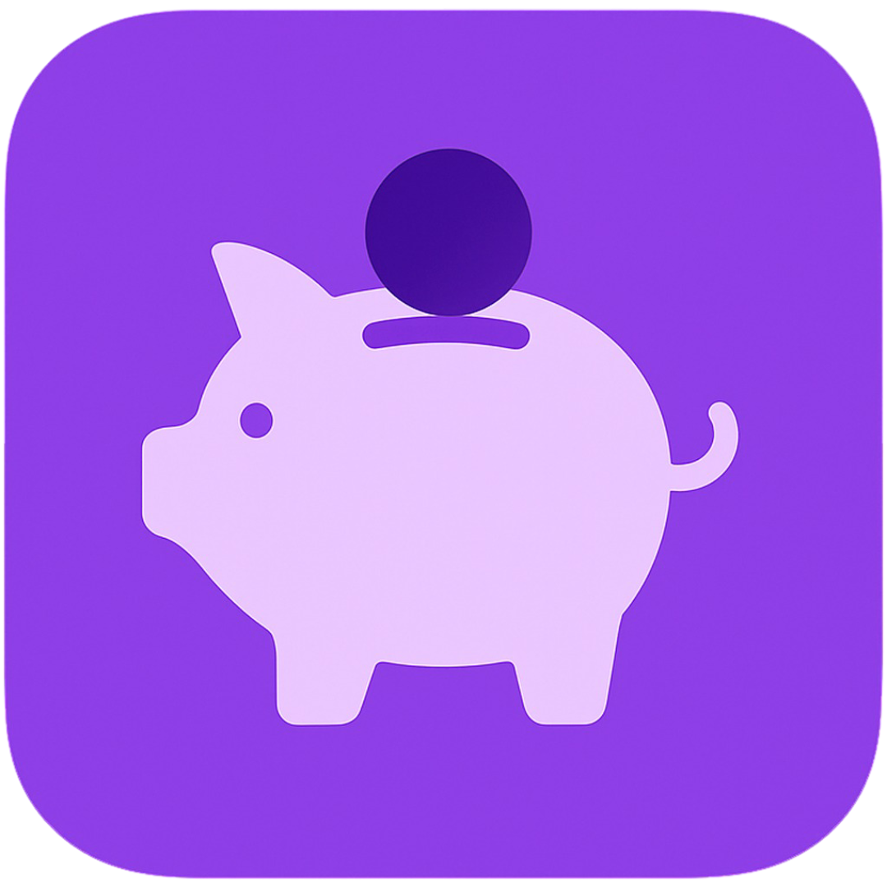
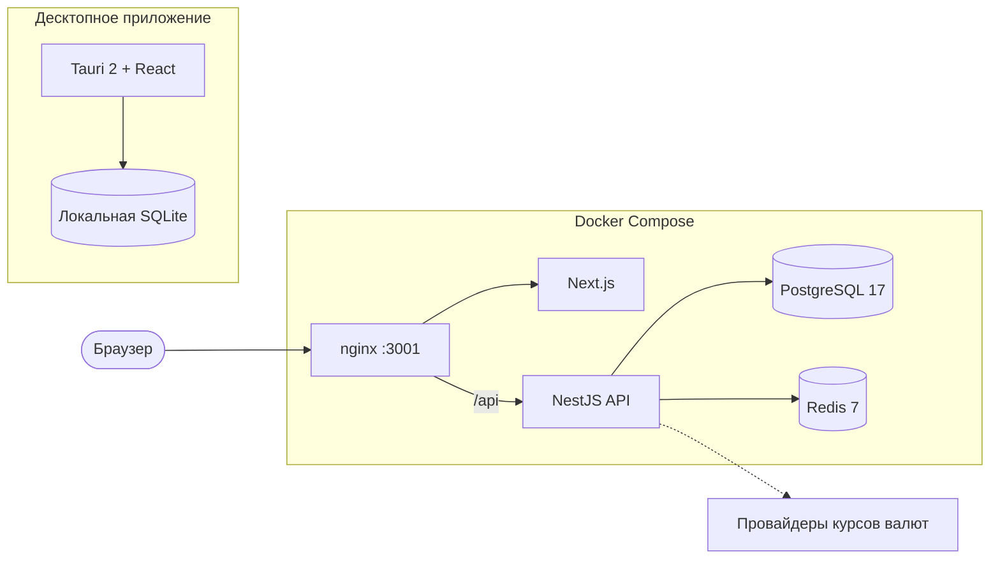

<div align="center">



<h1>MyMoney</h1>

**Личные финансы — онлайн и офлайн.**

Учитывайте доходы, расходы и переводы между мультивалютными счетами, смотрите, куда уходят деньги, и пользуйтесь приложением даже без подключения к сети.

[](https://github.com/zoom1fy/mymoney/releases)
[](LICENSE)
[](https://github.com/zoom1fy/mymoney/releases)

[](https://nextjs.org/)
[](https://nestjs.com/)
[](https://tauri.app/)

[English](README.md) · [Русский](README.ru.md) · [История изменений](CHANGELOG.md)

</div>

---

## О проекте

MyMoney — приложение для управления личными финансами, которое можно разместить на своём сервере: полноценное веб-приложение и десктопная версия, работающая офлайн.
Все счета, категории и транзакции хранятся в одном месте, мультивалютные балансы приводятся к одной базовой валюте, а история операций превращается в понятные графики.

Веб-версия работает на Next.js и NestJS с PostgreSQL, Redis и nginx. Десктопная версия оборачивает тот же интерфейс в Tauri и хранит данные в локальной базе SQLite — ей не нужны ни бэкенд, ни сеть.

Интерфейс приложения на русском языке; API и документация — на английском.

## Возможности

| Возможность | Что это даёт |
|---|---|
| 💸 **Мультивалютные счета** | Шесть типов счетов в четырёх группах сайдбара, у каждого своя иконка и валюта. Балансы остаются в исходной валюте, итоги по группам переводятся в RUB. |
| 📊 **Аналитика трат** | Круговые диаграммы доходов и расходов с фильтром по периоду. Агрегация выполняется на сервере, браузер только отрисовывает результат. |
| ⚡ **Дашборд за один запрос** | `GET /api/dashboard` возвращает профиль, счета, итоги по категориям, категории и обе сводки за один запрос. |
| 🔁 **Доходы, расходы, переводы** | Иерархические категории с цветами и иконками, описания, даты и история с cursor-пагинацией. Перевод обновляет оба счёта в одной транзакции БД. |
| 🔐 **Безопасность по умолчанию** | JWT access/refresh-токены, хеширование паролей Argon2, подтверждение email, одноразовые коды восстановления и два уровня ограничения запросов. |
| 💻 **Веб и десктоп** | Один и тот же React-интерфейс поставляется как сайт и как приложение Tauri с локальной SQLite, балансами на триггерах и ручными бэкапами. |
| 🎨 **Комфортный интерфейс** | Светлая и тёмная темы, оптимистичные обновления через TanStack Query, скелетоны загрузки, анимации и адаптивная вёрстка. |
| 🛠 **Готово к запуску** | Docker Compose, ночные бэкапы PostgreSQL, CI на GitHub Actions и сборки под несколько платформ. |

## Быстрый старт

### Требования

- [Docker Desktop](https://www.docker.com/products/docker-desktop/) или Docker Engine
- [Bun](https://bun.sh/) 1.2 или новее (нужен только для локальных скриптов и сборок)
- Git
- Свободные порты: `3001`, `4200`, `5432`, `6379`, `8080`

### 1. Клонируйте и настройте

```bash
git clone https://github.com/zoom1fy/mymoney.git
cd mymoney
cp .example.env .env
```

В Windows PowerShell вместо `cp` используйте `Copy-Item .example.env .env`.

Откройте `.env` и задайте как минимум эти значения:

```env
POSTGRES_USER=postgres
POSTGRES_PASSWORD=change-me
POSTGRES_DB=mymoneydb
DATABASE_URL=postgresql://postgres:change-me@db:5432/mymoneydb
JWT_SECRET=replace-with-a-long-random-string

# Нужны для подтверждения регистрации и восстановления пароля
SMTP_HOST=smtp.yandex.ru
SMTP_PORT=587
SMTP_USER=you@yandex.ru
SMTP_PASS=your-app-password
SMTP_FROM=you@yandex.ru
SMTP_TLS=true
```

У остальных переменных в `.example.env` уже есть рабочие значения по умолчанию.
Подтверждение email обязательно, поэтому SMTP-данные должны быть рабочими — иначе регистрацию не завершить.
Для Яндекс Почты используйте пароль приложения, а не пароль от аккаунта.

### 2. Запустите стек

```bash
# macOS / Linux
./deploy/deploy.sh

# Windows
deploy\deploy.bat
```

Скрипт спросит, какой режим запустить — development или production.
Чтобы пропустить вопрос и сразу поднять dev-стек:

```bash
bun run docker:up
```

Первая сборка занимает несколько минут. Миграции базы данных применяются
автоматически при старте контейнера бэкенда.

### 3. Откройте приложение

| Сервис | URL |
|---|---|
| MyMoney | <http://localhost:3001> |
| Adminer | <http://localhost:8080> |

Зарегистрируйтесь, подтвердите 6-значный код из письма — и дашборд будет
заполнен стартовыми категориями, двумя счетами и примерами транзакций.

## Десктопное приложение

Десктопная сборка полностью офлайн: вместо API она использует локальную базу
SQLite, поэтому не требует PostgreSQL, Redis и сервера.

- **Скачайте** последний MSI, DMG, AppImage, deb или rpm на странице
  [Releases](https://github.com/zoom1fy/mymoney/releases).
- **Сделайте бэкап** базы в разделе Настройки → Данные → Сохранить копию. Файл
  создаётся через SQLite `VACUUM INTO`, поэтому копия остаётся целостной даже
  во время работы приложения.

Для самостоятельной сборки нужны [зависимости Tauri](https://tauri.app/start/prerequisites/)
под вашу платформу, Rust toolchain и Bun:

```bash
bun run setup
bun run dev:desktop      # окно для разработки
bun run build:desktop    # инсталляторы в desktop/src-tauri/target/release/bundle
```

## Архитектура



Nginx публикует единый origin: всё под `/api` уходит в NestJS, остальное — в Next.js. Десктопное приложение вообще не обращается к серверу и запускает тот же фронтенд поверх SQLite.

## Технологии

| Слой | Стек |
|---|---|
| **Фронтенд** | Next.js 15 (App Router), React 19, Tailwind CSS 4, shadcn/ui, Recharts 3, TanStack Query 5, Framer Motion, React Hook Form |
| **Бэкенд** | NestJS 11, Prisma Next 8, PostgreSQL 17, Redis 7 + BullMQ, JWT + Passport, Argon2, Nodemailer |
| **Десктоп** | Tauri 2, Rust, SQLx, SQLite |
| **Инфраструктура** | Docker Compose, nginx, GitHub Actions, ночные бэкапы `pg_dump` |

## Структура репозитория

```
.
├── backend/     NestJS API, контракт Prisma и миграции
├── frontend/    Next.js-приложение для веба и десктопа
├── desktop/     Оболочка Tauri 2, Rust-код и миграции SQLite
├── deploy/      Compose-оверрайды и скрипты деплоя
├── db/          Образ PostgreSQL с cron для ночных бэкапов
└── nginx/       Обратный прокси и лимиты запросов
```

## Участие в разработке

Issues и pull requests приветствуются. Перед созданием pull request запустите те же проверки, что и CI:

```bash
bun run lint
bun run typecheck
bun run test
```

## Лицензия

MyMoney распространяется по лицензии [GNU Affero General Public License v3.0](LICENSE).
Если вы запускаете изменённую версию как сетевой сервис, вы обязаны предоставить
его пользователям исходный код.
